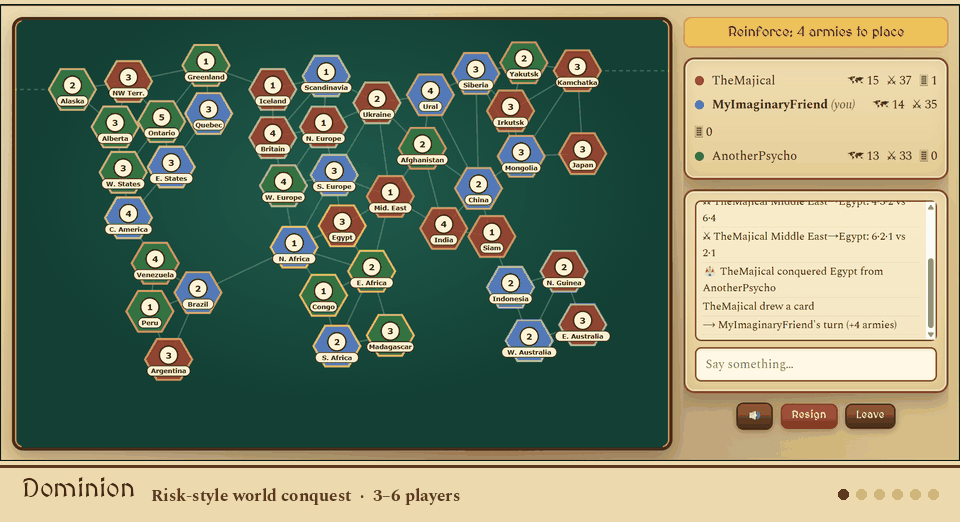

# 🏰 The Gathering Hall

A self-hosted multiplayer board-game platform for playing with friends in the
browser. No accounts and no third-party services, just a room code.

It is built to keep working when the global internet doesn't: the app makes
**zero external requests at runtime** (fonts, sounds and card art are all
bundled), so you can host it on a laptop, a home server or a domestic VPS and
play over a LAN or national intranet. See [Offline & shutdown use](#offline--internet-shutdown-use).



## Games

| Game | Players | Notes |
|---|---|---|
| 🏝 **Colonies of Cotton** | 3–4 | Settlers-style: snake draft, robber, dev cards, longest road / largest army, harbor & player trading, first to 10 VP |
| 🌍 **Dominion** | 3–6 | Risk-style world conquest: escalating card trades, blitz dice, connected-path fortify |
| 🂡 **Hokm** | 2–4 | Persian trick-taking card game |
| ♟ **Chess** | 2 | Rules via chess.js, drag & drop or click-to-move, all draw rules |
| 🃏 **Uno-style** | 2–8 | 108-card deck, draw-then-play, 2-player reverse = skip |
| ⚫ **Othello** | 2 | Classic disc-flipping rules |
| 🪙 **Coinflip** | 2–6 | Tiny game used to exercise the platform |

## Quick start

### Docker (recommended)

```bash
git clone https://github.com/TheMajical/gathering-hall.git gathering-hall && cd gathering-hall
docker compose up -d app        # game server on http://localhost:8080
```

Friends on the same network open `http://<your-machine-LAN-IP>:8080`.

To also expose it to the public internet through a free Cloudflare quick
tunnel (requires global internet access):

```bash
docker compose up -d            # app + cloudflared
./scripts/tunnel-url.sh         # prints the public https URL to share
```

The Docker build runs the whole test suite; the image is not produced if any
test fails.

### Without Docker

Requires **Node.js 22+**.

```bash
npm install
npm run build
node server/dist/index.js       # serves API, sockets and the built client on :8080
```

### Development

```bash
npm install
npm test                        # engine + integration suites
npm run typecheck
npm run dev:server              # API + sockets on :8080
npm run dev:client              # Vite dev server (proxies sockets to :8080)
```

## Configuration

| Variable | Default | Purpose |
|---|---|---|
| `PORT` | `8080` | HTTP / WebSocket port |
| `DATA_DIR` | `./data` (`/data` in Docker) | Where room snapshots are written |
| `CLIENT_DIR` | `client/dist` | Built client assets to serve |

Limits: at most 50 concurrent rooms, 24-character player names, 500-character
chat messages. Finished games are cleaned up after 24 hours.

## How it works

- **npm-workspaces monorepo**: `shared/` (pure TypeScript game engines and the
  typed socket protocol), `server/` (Express + Socket.IO), `client/` (React + Vite)
- **Server-authoritative**: every move is validated by a pure engine reducer,
  and clients only receive their own redacted view (no peeking at hands)
- **Deterministic**: a seeded, serializable RNG lives inside game state, so
  replays, snapshots and tests are exact
- **Reconnect-proof**: seat tokens are stored in the browser's `localStorage`.
  Refresh mid-game and you get your seat back, and games snapshot to disk and
  survive server restarts
- **One contract, many games**: each engine implements
  `setup / getLegalActions / reduce / view / getCurrentActors / status` and
  registers in one line
- **Well tested**: unit, property-based full-game and socket-level integration
  tests (150+ in total), including mid-game disconnect/reconnect

Full design write-up: [docs/ARCHITECTURE.md](docs/ARCHITECTURE.md).
To add a game, follow the recipe in section 11 of that document.

## Offline & internet-shutdown use

Everything the game needs is served by your own server. What changes during a
shutdown is only *how friends reach you* (the Cloudflare tunnel won't work) and
how you rebuild images without Docker Hub or npm.

- **Same LAN / wifi**: `docker compose up -d app`, share `http://<LAN-IP>:8080`
- **Home hosting over domestic routing**: port-forward `8080` (watch out for CGNAT)
- **Domestic VPS**: load the exported image and run the app there

Step-by-step preparation checklist and runbooks (backups, offline rebuilds,
git bundles): [docs/SURVIVAL.md](docs/SURVIVAL.md).
Prepare while the internet still works: `./scripts/survival-backup.sh`.

## Security notes

This is designed for **friends-and-family hosting**, not hardened public
hosting. Room codes are the only access control, and there is no rate limiting
or authentication. If you expose it publicly, put it behind a reverse proxy
and keep dependencies up to date (`npm audit`).

## Project layout

```
shared/    game engines, RNG, socket protocol (pure TypeScript)
server/    Express + Socket.IO, rooms, seats, persistence
client/    React SPA, one renderer per game
scripts/   tunnel-url.sh, survival-backup.sh, gen-sounds.mjs
docs/      ARCHITECTURE.md, SURVIVAL.md
```

## Credits & licenses

- Sound effects and playing-card images: [Kenney](https://kenney.nl) asset
  packs, CC0. Synthesized WAV fallbacks come from `scripts/gen-sounds.mjs`.
  See `client/public/sounds/CREDITS.txt`.
- Fonts (self-hosted): Spectral and MedievalSharp, from Google Fonts. Both are
  under the SIL Open Font License.
- Chess rules: [chess.js](https://github.com/jhlywa/chess.js) (BSD-2-Clause).
- Game names are generic or original; this project is not affiliated with the
  publishers of any commercial board game it resembles.